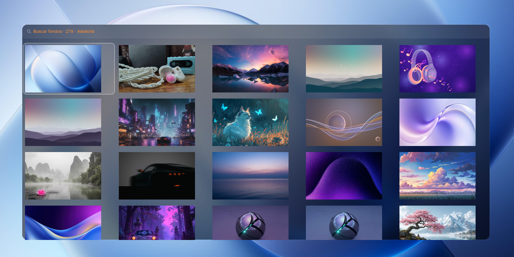

# wofi-wallselect

Selector de fondos de pantalla para **wofi** que aplica la imagen a través de
**DMS (DankMaterialShell / Dux Shell)**, por lo que se reproducen sus
transiciones animadas: fundido, barrido, disco, iris bloom, pixelado, portal…

Pensado para sesiones Wayland con DMS, pero incluye respaldos para `swww` y
`swaybg` si DMS no está disponible.



## Características

- Rejilla responsive de miniaturas (4 o 5 columnas según la resolución).
- Búsqueda en vivo por nombre de archivo.
- Fondo del menú difuminado a partir del wallpaper actual.
- El fondo que tienes puesto aparece primero, listo para aplicar con `Enter`.
- Miniaturas cacheadas y regeneradas automáticamente al añadir fondos.
- Entrada «Ajustes de transición» al final del menú para abrir la pestaña
  Wallpaper de DMS.
- Notificaciones «Fondo cambiado» y «Tema aplicado».
- Aplicación por DMS con transiciones animadas; respaldo a `swww`/`swaybg`.

## Requisitos

Resumen: `wofi` (1.4.1 o superior), `bash` y, recomendado, `DMS`. Para
miniaturas y fondo difuminado hace falta `ImageMagick`.

Consulta el detalle y los comandos por distribución en
[REQUIREMENTS.md](REQUIREMENTS.md).

## Instalación

```bash
git clone https://github.com/Jolmas/wofi-wallselect.git
cd wofi-wallselect
chmod +x install.sh
./install.sh
```

El instalador:

1. Copia `wallselect.sh`, `style.css` y `wofi.conf` a
   `~/.config/wofi/wallselect/`.
2. Instala `config.sh` solo si no existe (no pisa tu configuración).
3. Genera la caché de miniaturas en `~/.cache/wofi-wallselect/` (conserva la
   estructura de carpetas de `WALL_DIR`).
4. Respalda cualquier archivo previo como `*.bak.AAAAAMMDD-HHMMSS`.

Opciones:

```bash
./install.sh --no-thumbs   # no generar miniaturas ahora
./install.sh --help
```

También puedes usar `make install`, `make check` o `make thumbs`.

### Instalación manual

```bash
install -Dm755 src/wallselect.sh ~/.config/wofi/wallselect/wallselect.sh
install -Dm644 src/style.css     ~/.config/wofi/wallselect/style.css
install -Dm644 src/wofi.conf     ~/.config/wofi/wallselect/wofi.conf
install -Dm644 src/config.sh     ~/.config/wofi/wallselect/config.sh
mkdir -p ~/.cache/wofi-wallselect/thumbs
~/.config/wofi/wallselect/wallselect.sh --generate-thumbs
```

## Uso

```bash
~/.config/wofi/wallselect/wallselect.sh           # abrir el menú
~/.config/wofi/wallselect/wallselect.sh --random  # fondo al azar
~/.config/wofi/wallselect/wallselect.sh --set RUTA
~/.config/wofi/wallselect/wallselect.sh --dir RUTA
~/.config/wofi/wallselect/wallselect.sh --generate-thumbs
~/.config/wofi/wallselect/wallselect.sh --help
```

| Tecla          | Acción                                       |
| -------------- | -------------------------------------------- |
| `Enter`        | Aplicar el fondo seleccionado                |
| `Esc`          | Cerrar                                       |

El menú muestra solo las miniaturas. Escribe parte del nombre del archivo para
filtrar la rejilla. La última entrada, «⚙ Ajustes de transición», abre la
pestaña Wallpaper de DMS (wofi no permite asignar un atajo personalizado de un
solo uso para esa acción).

## Integración

**labwc** (`~/.config/labwc/rc.xml`):

```xml
<keybind key="W-F2">
  <action name="Execute" command="$HOME/.config/wofi/wallselect/wallselect.sh"/>
</keybind>
```

**Hyprland** (`~/.config/hypr/hyprland.conf`):

```ini
bind = SUPER, W, exec, ~/.config/wofi/wallselect/wallselect.sh
```

**Waybar** (módulo personalizado):

```json
"custom/wallpaper": {
  "format": "󰸉",
  "tooltip": "Cambiar fondo",
  "on-click": "~/.config/wofi/wallselect/wallselect.sh"
}
```

## Configuración

Edita `~/.config/wofi/wallselect/config.sh` (todas las opciones son opcionales):

| Variable          | Por defecto                             | Descripción                                     |
| ----------------- | --------------------------------------- | ----------------------------------------------- |
| `WALL_DIR`        | `~/Imágenes/Wallpapers`                 | Carpeta de fondos                               |
| `THEME`           | `~/.config/wofi/wallselect/style.css`   | Tema CSS de wofi                                |
| `WOFI_CONF`       | `~/.config/wofi/wallselect/wofi.conf`   | Configuración propia de wofi (posición, modo…)  |
| `CACHE_DIR`       | `~/.cache/wofi-wallselect`              | Caché de miniaturas y fondos difuminados        |
| `THUMB_W/H`       | `480` / `300`                           | Tamaño de las miniaturas                        |
| `ROWS`            | `4`                                     | Filas visibles del menú                         |
| `MAX_HEIGHT_PCT`  | `85`                                    | Alto máximo de la ventana (% de la pantalla)    |
| `SHUFFLE`         | `0`                                     | `1` = orden aleatorio al abrir el menú          |
| `NOTIFY`          | `1`                                     | `0` = sin notificaciones                        |
| `THEME_NOTIFY`    | `1`                                     | `0` = sin aviso «Tema aplicado»                 |
| `JOBS`            | núcleos de CPU                          | Procesos en paralelo al generar miniaturas      |
| `NORMAL_WINDOW`   | `0`                                     | `1` = ventana normal en vez de layer-shell      |

La posición y el comportamiento del menú se definen en
`~/.config/wofi/wallselect/wofi.conf`, que se pasa a wofi con `--conf`. Así el
selector no hereda los offsets ni otras opciones de `~/.config/wofi/config`.
Si las filas configuradas no caben en pantalla, `wallselect.sh` reduce las
visibles automáticamente.

## Transiciones

Las transiciones pertenecen a DMS. Valores disponibles:

`none`, `fade`, `wipe`, `disc`, `stripes`, `iris bloom`, `pixelate`, `portal` y
`random`.

También puedes editar `~/.local/state/dms/session.json`:

```json
{ "wallpaperTransition": "random" }
```

y reiniciar DMS para que lo lea:

```bash
systemctl --user restart dms
```

## Caché y resolución de problemas

- **No se ven las miniaturas**: instala ImageMagick y ejecuta
  `wallselect.sh --generate-thumbs`. Sin miniaturas el menú usa las imágenes
  originales, lo que puede tardar más.
- **No aparece el fondo difuminado**: falta ImageMagick; el menú sigue
  funcionando con color sólido.
- **wofi no abre o se cierra al instante**: necesita un compositor con
  `wlr-layer-shell` (labwc, sway, Hyprland…). En otros entornos prueba
  `NORMAL_WINDOW=1` en `config.sh`.
- **El menú no aparece centrado**: no definas `xoffset` ni `yoffset` en
  `wofi.conf` mientras uses `location=center`; wofi recoloca la ventana en la
  esquina superior izquierda si detecta cualquier offset. Usa siempre el
  `wofi.conf` del proyecto (se pasa con `--conf`) en lugar de depender de
  `~/.config/wofi/config`. Con `NORMAL_WINDOW=1` el script desactiva
  `--lines` para que el compositor pueda centrar la ventana al abrirse.
- **La búsqueda no encuentra un fondo**: escribe parte del nombre del archivo
  o de su subcarpeta dentro de `WALL_DIR`. La búsqueda no distingue mayúsculas
  de minúsculas.
- **Revisar errores de wofi**: consulta `~/.cache/wofi-wallselect/wofi.log`.
  El aviso `gtk_widget_set_size_request: assertion 'height >= -1' failed` es
  interno de wofi 1.4.1 y no afecta al menú.
- **swww falla con `InvalidEnumDiscriminant(("Format", ...))`**: usa DMS. Este
  script ya prioriza DMS y solo recurre a `swww`/`swaybg` si no está.
- **DMS no responde**: comprueba `systemctl --user status dms`.
- **El cambio de transición no surte efecto**: es un ajuste de DMS; cámbialo
  desde su interfaz (o edita `session.json` y reinicia DMS).

## Desinstalación

```bash
./uninstall.sh          # conserva config.sh y la caché
./uninstall.sh --purge  # elimina también config.sh y la caché
```

## Estructura del proyecto

```
wofi-wallselect/
├── install.sh
├── uninstall.sh
├── Makefile
├── README.md
├── DESCRIPTION.md
├── REQUIREMENTS.md
├── LICENSE
└── src/
    ├── wallselect.sh
    ├── style.css
    ├── wofi.conf
    └── config.sh
```

## Entorno probado

- wofi `1.4.1`
- Wayland + labwc
- DMS (DankMaterialShell)
- Pantalla 1920×1080 (`eDP-1`)

## Licencia

MIT. Consulta [LICENSE](LICENSE).
